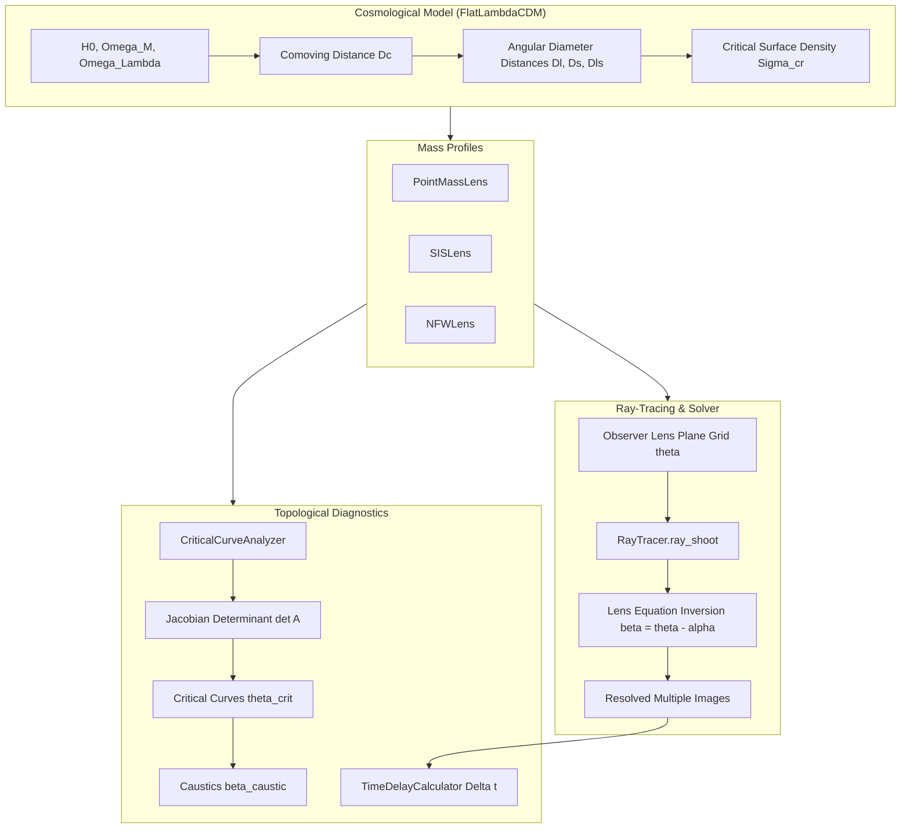

# CosmoLensing

[](https://github.com/ZengLLQ/cosmo-lensing/actions)
[](https://opensource.org/licenses/MIT)
[](https://www.python.org/)
[](https://en.wikipedia.org/wiki/Gravitational_lens)

**CosmoLensing** is a high-precision, mathematically rigorous gravitational lensing ray-tracing and cosmological deflection engine in Python. It models strong and weak gravitational lensing phenomena across flat $\Lambda\text{CDM}$ cosmologies, computing deflection angles, lensing potentials, critical curves, caustics, and relative image arrival time delays.

---

## Theoretical Foundations

### 1. The Lens Equation

Light rays propagating from a source at angular position $\boldsymbol{\beta}$ are deflected by a mass distribution at lens redshift $z_l$ to observed image positions $\boldsymbol{\theta}$:

$$
\boldsymbol{\beta} = \boldsymbol{\theta} - \boldsymbol{\alpha}(\boldsymbol{\theta})
$$

Where the scaled deflection angle $\boldsymbol{\alpha}(\boldsymbol{\theta})$ is related to the effective 2D lensing potential $\psi(\boldsymbol{\theta})$:

$$
\boldsymbol{\alpha}(\boldsymbol{\theta}) = \boldsymbol{\nabla}_{\boldsymbol{\theta}} \psi(\boldsymbol{\theta})
$$

### 2. Navarro-Frenk-White (NFW) Dark Matter Profile

For a cold dark matter halo with 3D density profile $\rho(r) = \frac{\rho_s}{(r/r_s)(1 + r/r_s)^2}$, the projected surface density $\Sigma(x)$ where $x = \theta / \theta_s$ leads to the analytic deflection magnitude:

$$
\alpha(x) = \frac{4 \kappa_s \theta_s}{x} \left[ \ln\left(\frac{x}{2}\right) + \mathcal{F}(x) \right]
$$

With piecewise radial function $\mathcal{F}(x)$:

$$
\mathcal{F}(x) = \begin{cases}
\frac{2}{\sqrt{1-x^2}}\operatorname{arctanh}\sqrt{\frac{1-x}{1+x}}, & x < 1 \\
1, & x = 1 \\
\frac{2}{\sqrt{x^2-1}}\arctan\sqrt{\frac{x-1}{1+x}}, & x > 1
\end{cases}
$$

The exact 2D potential is given by:

$$
\psi(x) = 4 \kappa_s \theta_s^2 \left[ \frac{1}{2}\ln^2\left(\frac{x}{2}\right) \pm 2 \mathcal{C}^2(x) \right]
$$

Satisfying $\frac{d\psi}{d\theta} = \alpha(\theta)$ down to machine precision.

### 3. Jacobian Magnification Matrix & Critical Curves

The distortion of infinitesimal light bundles is governed by the Jacobian matrix $A$:

$$
A = \frac{\partial \boldsymbol{\beta}}{\partial \boldsymbol{\theta}} = \begin{pmatrix} 1 - \kappa - \gamma_1 & -\gamma_2 \\ -\gamma_2 & 1 - \kappa + \gamma_1 \end{pmatrix}
$$

The eigenvalues are tangential $\lambda_t = 1 - \kappa - \gamma$ and radial $\lambda_r = 1 - \kappa + \gamma$, yielding the signed point magnification:

$$
\mu = \frac{1}{\det A} = \frac{1}{(1 - \kappa)^2 - \gamma_1^2 - \gamma_2^2}
$$

Critical curves occur where $\det A = 0$ ($\mu \to \infty$). Their mapping onto the source plane defines the caustics:

$$
\boldsymbol{\beta}_{\text{caustic}} = \boldsymbol{\theta}_{\text{crit}} - \boldsymbol{\alpha}(\boldsymbol{\theta}_{\text{crit}})
$$

### 4. Fermat Potential & Gravitational Time Delay

The excess light travel time relative to the undeflected line of sight is governed by the Fermat potential $\tau$:

$$
\tau(\boldsymbol{\theta}, \boldsymbol{\beta}) = \frac{1}{2}|\boldsymbol{\theta} - \boldsymbol{\beta}|^2 - \psi(\boldsymbol{\theta})
$$

$$
\Delta t = \frac{1 + z_l}{c} \frac{D_l D_s}{D_{ls}} \tau(\boldsymbol{\theta}, \boldsymbol{\beta}) = \frac{D_{\Delta t}}{c} \tau(\boldsymbol{\theta}, \boldsymbol{\beta})
$$

---

## Architectural Flow



---

## Module Layout

```
src/cosmo_lensing/
├── __init__.py         # Public exports and library version
├── constants.py        # Physical constants (G, c, M_sun, Mpc, conversions)
├── cosmology.py        # FlatLambdaCDM distance integrals and Sigma_cr
├── models/
│   ├── base.py         # BaseLens abstract interface and finite-diff shear
│   ├── point_mass.py   # Schwarzschild point mass lens
│   ├── sis.py          # Singular Isothermal Sphere model
│   └── nfw.py          # Navarro-Frenk-White dark matter profile
├── raytrace.py         # RayTracer, root-finding solver, extended source rendering
├── magnification.py    # CriticalCurveAnalyzer, Jacobian matrix, caustics
└── timedelay.py        # Fermat potential and image relative arrival delays
```

---

## Installation & Testing

```bash
# Clone repository
git clone https://github.com/ZengLLQ/cosmo-lensing.git
cd cosmo-lensing

# Install package in development mode
pip install -e .[dev]

# Run unit and integration tests
pytest -v
```

---

## License

This project is open source and available under the [MIT License](LICENSE).
